# Odoo Purchase Request

**EN** — A custom Odoo 19 module that implements a complete **Procure-to-Pay** workflow: purchase request → two-level approval → purchase order, with an expense analytics dashboard.
**FR** — Module Odoo 19 personnalisé qui implémente un workflow **Procure-to-Pay** complet : demande d'achat → approbation à deux niveaux → bon de commande, avec un tableau de bord d'analyse des dépenses.


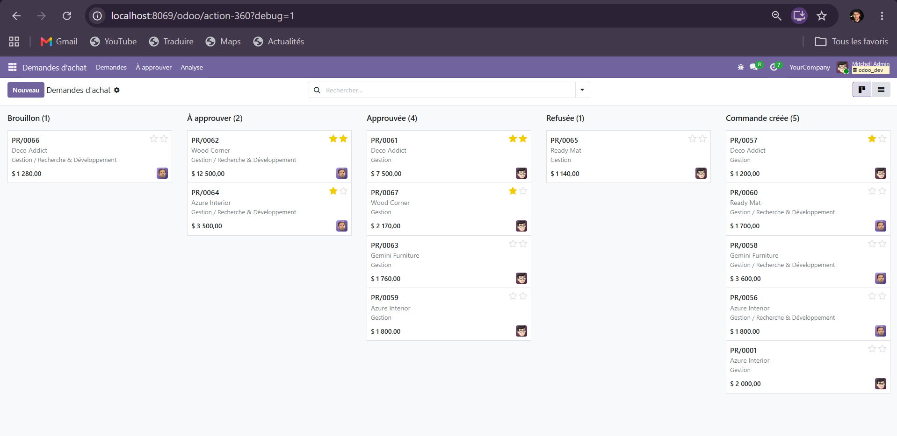

---

## English

### Features

- **Purchase requests** with product lines, computed totals, priority, justification and an automatic sequence (`PR/0001`)
- **Two-level approval** driven by the amount (see the table below), enforced in Python, not only in the UI
- **Full traceability**: approver, approval date, status changes and activities logged in the chatter (`mail.thread`)
- **One-click purchase order**: an approved request generates a native Odoo `purchase.order`
- **Manager notifications**: submitting a request schedules a to-do activity for the right approvers
- **Data integrity**: positive quantities, non-negative prices, state transitions checked, processed requests cannot be deleted
- **Department** resolved automatically from the requester's employee record (`hr`)
- **Views**: Kanban (columns follow the workflow), colour-coded list, form with an approval-level alert, advanced search and grouping
- **Expense analytics**: bar, line and pie charts plus pivot tables by vendor, month and department
- **PDF report** of each request, with company branding
- **Record rules**: users only see their own requests, managers see everything
- **Demo data script** and **20 unit tests** (`TransactionCase`)

### Workflow

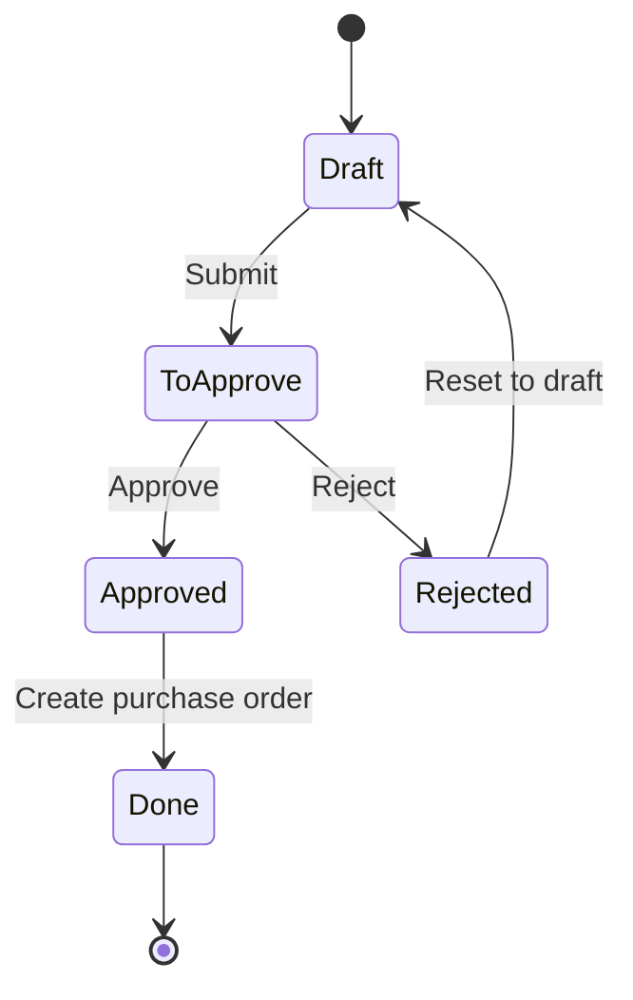

### Approval rules and roles

| Request total | Required approval level | Who can approve |
|---|---|---|
| up to 1,000 | User | any user of the module |
| 1,000 – 10,000 | Manager | Manager or Director |
| above 10,000 | Director | Director only |

| Group | Can do |
|---|---|
| **User** | Create and submit requests, see **their own** requests |
| **Manager** | See all requests, approve up to 10,000, create purchase orders, access the analytics |
| **Director** | Everything a Manager can do, plus approve above 10,000 |

The Odoo administrator is automatically a Director. The thresholds are constants at the top of [`models/purchase_request.py`](addons/purchase_request/models/purchase_request.py).

### Screenshots

| | |
|---|---|
| **List view** 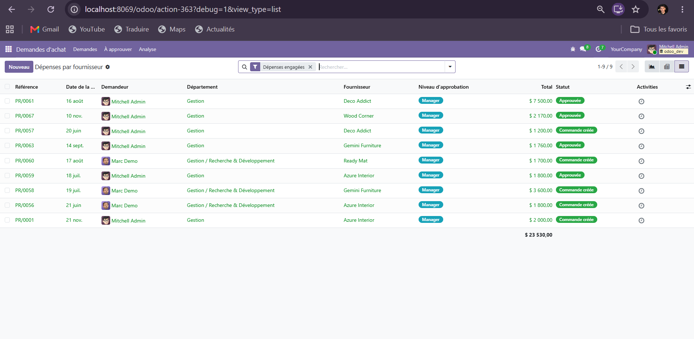 | **Form with approval-level alert** 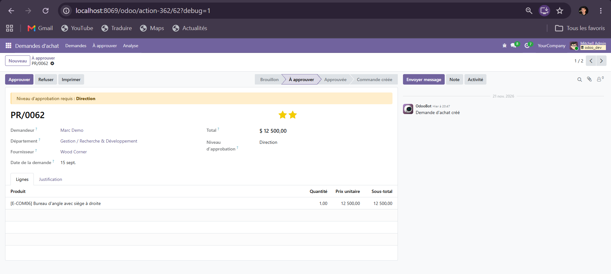 |
| **Spend by vendor** 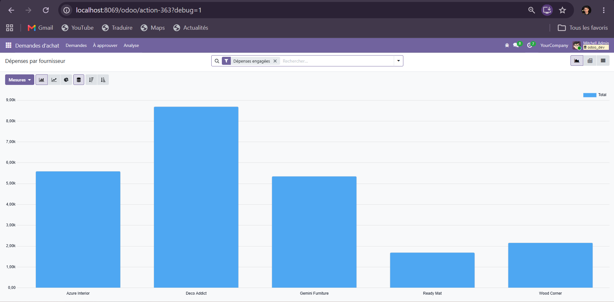 | **Spend by vendor (pie)** 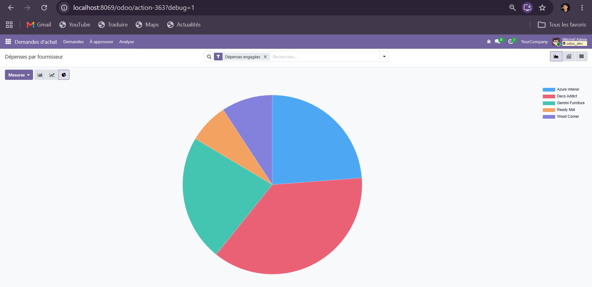 |
| **Monthly trend** 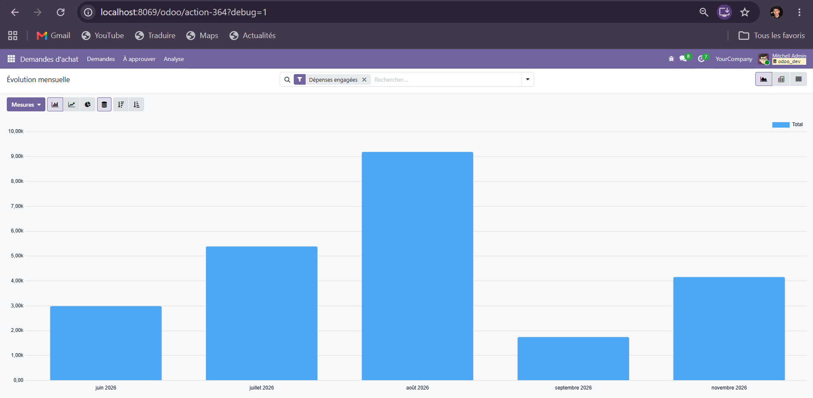 | **Spend by department** 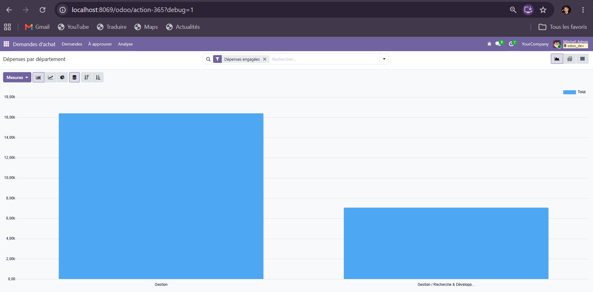 |
| **Pivot: vendor × month** 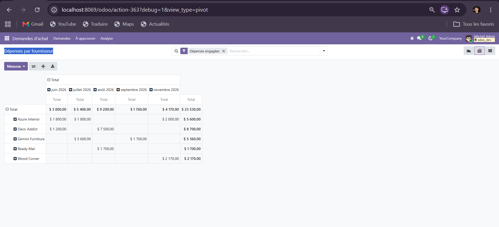 | **Generated purchase order** 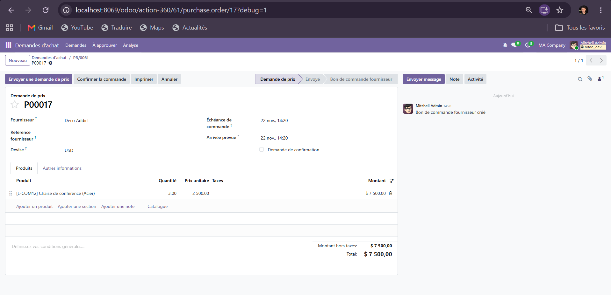 |

**PDF report**

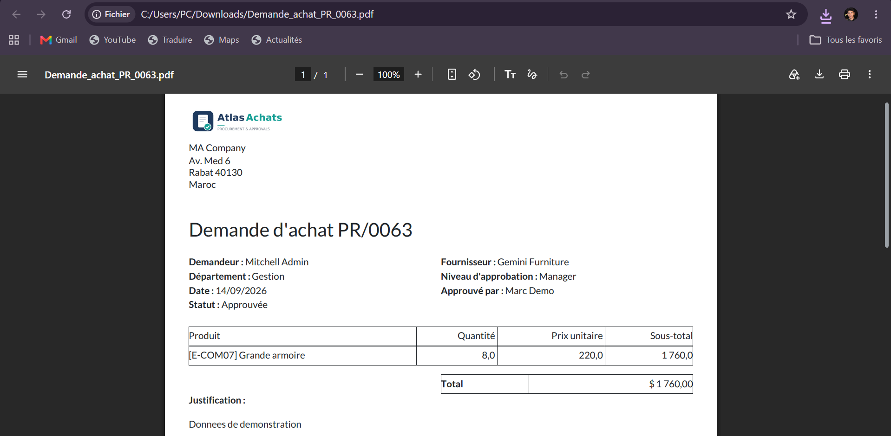

### Quick start

Requirements: [Docker Desktop](https://www.docker.com/products/docker-desktop/) (or Docker Engine + Compose).

```bash
git clone https://github.com/ELhamdani-nabil/odoo-purchase-request.git
cd odoo-purchase-request
docker compose up -d
```

1. Open <http://localhost:8069> and create a database named `odoo_dev` (tick *Demo data*)
2. Enable developer mode: <http://localhost:8069/odoo/apps?debug=1>
3. Activate the **Purchase** and **Employees** apps
4. *Apps → Update Apps List*, remove the *Apps* filter, search `purchase_request` and click **Activate**

Load the demo data (12 requests spread over 6 months, so the charts are populated):

```bash
docker compose run --rm -T odoo odoo shell -d odoo_dev < scripts/seed_demo_data.py
```

### Run the tests

```bash
docker compose run --rm odoo odoo -d odoo_dev -u purchase_request \
  --test-tags /purchase_request --stop-after-init
```

Expected result: `0 failed, 0 error(s) of 20 tests`.

The tests cover totals and sequence, approval levels, role checks, state transitions, traceability, deletion rules, notifications and the expense aggregation used by the dashboard.

### Project structure

```
odoo-purchase-request/
├── docker-compose.yml          # Odoo 19 + PostgreSQL 16
├── scripts/
│   └── seed_demo_data.py       # demo data for the analytics
├── docs/screenshots/
└── addons/purchase_request/
    ├── __manifest__.py
    ├── models/                 # purchase.request, purchase.request.line
    ├── views/                  # kanban, list, form, search, graph, pivot, menus
    ├── security/               # groups, access rights, record rules
    ├── data/                   # sequence
    ├── report/                 # QWeb PDF report
    └── tests/                  # 20 unit tests
```

### Relation with Oracle processes

| Oracle (Procure-to-Pay / Record-to-Report) | This module |
|---|---|
| Requisition | Purchase request |
| Approval hierarchy | Two-level approval based on the amount |
| Purchase order | Generated `purchase.order` |
| Spend analysis (Record-to-Report) | Analytics by vendor, month and department |

### Design decisions

- **Approval rules live in the model, not in the views.** Hiding a button is not security: the check runs in `action_approve`, so it also applies to RPC calls and imports.
- **Kanban columns cannot be dragged.** Dragging a card would bypass the workflow, so state changes only go through the buttons.
- **Approval level is a stored computed field.** It can be grouped and filtered, and it drives the notifications.
- **Record rules on both models.** Request lines follow the same visibility rules as their parent request.

---

## Français

### Fonctionnalités

- **Demandes d'achat** avec lignes de produits, total calculé, priorité, justification et séquence automatique (`PR/0001`)
- **Approbation à deux niveaux** selon le montant (voir le tableau ci-dessous), appliquée en Python et pas seulement dans l'interface
- **Traçabilité complète** : approbateur, date d'approbation, changements de statut et activités dans le chatter
- **Bon de commande en un clic** : une demande approuvée génère un `purchase.order` natif d'Odoo
- **Notifications** : la soumission crée une activité « à faire » pour les bons approbateurs
- **Intégrité des données** : quantités positives, prix non négatifs, transitions d'état contrôlées, suppression interdite après traitement
- **Département** déterminé automatiquement à partir de la fiche employé du demandeur
- **Vues** : Kanban (colonnes dans l'ordre du workflow), liste colorée par statut, formulaire avec alerte de niveau d'approbation, recherche et regroupements
- **Analyse des dépenses** : graphiques en barres, courbes et secteurs, plus des tableaux croisés par fournisseur, mois et département
- **Rapport PDF** de chaque demande, avec l'identité de la société
- **Règles d'accès** : un utilisateur ne voit que ses demandes, un manager voit tout
- **Script de données de démonstration** et **20 tests unitaires**

### Règles d'approbation et rôles

| Total de la demande | Niveau requis | Qui peut approuver |
|---|---|---|
| jusqu'à 1 000 | Utilisateur | tout utilisateur du module |
| de 1 000 à 10 000 | Manager | Manager ou Direction |
| au-delà de 10 000 | Direction | Direction uniquement |

| Groupe | Droits |
|---|---|
| **Utilisateur** | Créer et soumettre des demandes, voir **ses propres** demandes |
| **Manager** | Voir toutes les demandes, approuver jusqu'à 10 000, créer les bons de commande, accéder aux analyses |
| **Direction** | Tout ce que fait un Manager, plus l'approbation au-delà de 10 000 |

L'administrateur Odoo est automatiquement Direction. Les seuils sont des constantes en haut de [`models/purchase_request.py`](addons/purchase_request/models/purchase_request.py).

### Démarrage rapide

Prérequis : [Docker Desktop](https://www.docker.com/products/docker-desktop/).

```bash
git clone https://github.com/ELhamdani-nabil/odoo-purchase-request.git
cd odoo-purchase-request
docker compose up -d
```

1. Ouvrir <http://localhost:8069> et créer une base `odoo_dev` (cocher *Demo data*)
2. Activer le mode développeur : <http://localhost:8069/odoo/apps?debug=1>
3. Activer les applications **Achats** et **Employés**
4. *Apps → Mettre à jour la liste des Apps*, retirer le filtre *Apps*, chercher `purchase_request` et cliquer sur **Activer**

Charger les données de démonstration (12 demandes sur 6 mois) :

```bash
docker compose run --rm -T odoo odoo shell -d odoo_dev < scripts/seed_demo_data.py
```

### Lancer les tests

```bash
docker compose run --rm odoo odoo -d odoo_dev -u purchase_request \
  --test-tags /purchase_request --stop-after-init
```

Résultat attendu : `0 failed, 0 error(s) of 20 tests`.

### Correspondance avec les processus Oracle

| Oracle (Procure-to-Pay / Record-to-Report) | Ce module |
|---|---|
| Réquisition | Demande d'achat |
| Hiérarchie d'approbation | Approbation à deux niveaux selon le montant |
| Bon de commande | `purchase.order` généré |
| Analyse des dépenses | Analyses par fournisseur, mois et département |

---

## Possible next steps

- Vendor-specific approval thresholds and delegation when an approver is absent
- Budget control per department, with a warning when the budget is exceeded
- Email templates and a customer-portal view of the request status
- French translation file (`i18n/fr.po`) so the labels are translatable

## Author

**ELhamdani Nabil** — [GitHub](https://github.com/ELhamdani-nabil)

## License

LGPL-3.0, the same license as Odoo Community.
